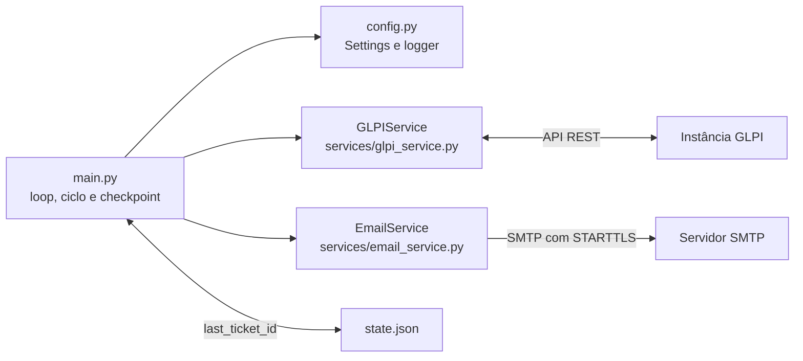

# Visão geral da arquitetura

## Objetivo

O programa funciona como um poller independente: consulta a API REST do GLPI periodicamente, encontra tickets com identificador maior que o checkpoint salvo e tenta enviar uma notificação SMTP para cada ticket. O corpo da mensagem inclui dados do ticket e anexos baixados do GLPI.

## Componentes

- **Orquestração:** `main.py` inicia o serviço, trata sinais de encerramento, executa ciclos e persiste o avanço após um envio bem-sucedido.
- **Configuração:** `config.py` carrega variáveis com `python-dotenv`, define `Settings` e configura logging.
- **Integração GLPI:** `GLPIService` autentica, consulta tickets e obtém atores e documentos.
- **Notificação:** `EmailService` monta o HTML, anexa arquivos e envia por SMTP.
- **Estado:** arquivo JSON local, sem banco de dados.

## Tecnologias e dependências

- Python; o código usa anotações com união `|`, exigindo sintaxe de Python 3.10 ou superior.
- `requests` e `python-dotenv`, declaradas em [`requirements`](../../../requirements).
- SMTP e MIME da biblioteca padrão do Python para envio de e-mail.
- Não foram encontrados frameworks web, fila, banco de dados, arquivos de build ou testes automatizados.

## Comportamentos arquiteturais relevantes

O identificador do ticket é usado como cursor crescente. Em cada ciclo, a implementação busca IDs percorrendo páginas do recurso `/Ticket`, ordena os IDs maiores que o checkpoint e consulta os detalhes individualmente. Assim, a listagem percorre a coleção do GLPI novamente em cada ciclo; o custo tende a crescer com o volume histórico.

A paginação tem uma trava definida no código para evitar varredura além de 20.000 posições. A implementação não usa um filtro de criação na consulta da API.

## Relações

- [[02 - Modulos/Indice|Detalhes dos componentes]]
- [[03 - Fluxos/Notificacao|Sequência de execução]]
- [[04 - Dados/Checkpoint local|Estado e recuperação]]
- [[05 - Interfaces e Integracoes/Indice|Contratos externos]]
- [[06 - Desenvolvimento/Configuracao e execucao|Preparação e execução]]
- [[08 - Pendencias/Pontos a confirmar|Pontos sem confirmação operacional]]

Voltar para [[01 - Arquitetura/Indice|Índice de Arquitetura]].
