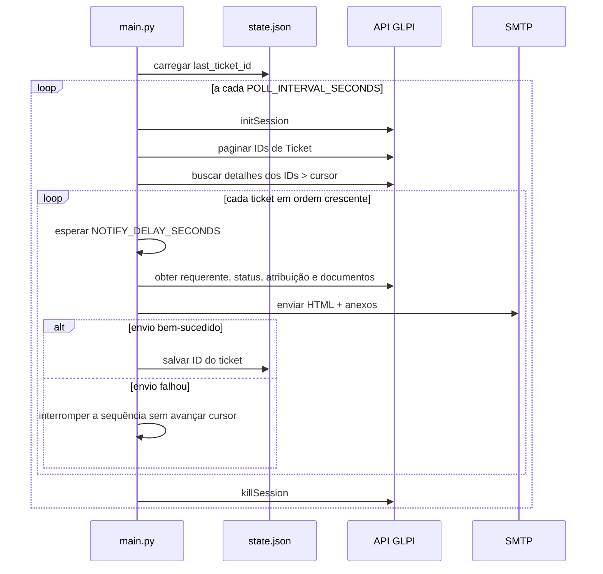

# Fluxo de notificação

O fluxo é coordenado por `main()` e `run_cycle()` em [`main.py`](../../../main.py).

## Sequência observada

1. `main()` lê o checkpoint. Se ainda não existe, aplica `SKIP_BACKLOG_ON_FIRST_RUN`: pula o backlog até o maior ID encontrado ou começa em zero para processar o histórico.
2. `run_cycle()` abre sessão GLPI. Se falhar, registra erro e mantém o cursor atual.
3. O serviço GLPI obtém as páginas de IDs, seleciona IDs acima do cursor em ordem crescente e busca os detalhes.
4. Para cada ticket, o processo aguarda o delay. Se recebeu sinal durante essa espera, não envia aquele e-mail; a próxima execução poderá tentar novamente.
5. Obtém requerente, status, atribuição, conteúdo e documentos; envia e-mail.
6. Sucesso: atualiza e salva o ID. Falha de envio: para a sequência, preservando o cursor anterior. Por fim, encerra a sessão.
7. O loop aguarda o intervalo e repete. Exceções inesperadas do ciclo são registradas por `logger.exception`.

## Consequências

- É uma entrega sequencial, sem paralelismo ou fila.
- O checkpoint representa o último ticket cujo e-mail retornou sucesso, não um registro individual de tentativas.
- Erros ao obter anexos podem resultar em envio sem todos os arquivos, pois o serviço GLPI pode retornar uma lista vazia após falha.
- O cursor baseado em ID assume que IDs crescentes são suficientes para distinguir novos tickets.

Veja [[02 - Modulos/Orquestrador|Orquestrador]], [[02 - Modulos/Servico GLPI|Serviço GLPI]], [[02 - Modulos/Servico de email|Serviço de e-mail]] e [[04 - Dados/Checkpoint local|Checkpoint]].

Voltar para [[03 - Fluxos/Indice|Índice de Fluxos]].
